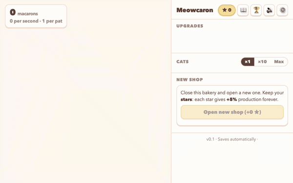
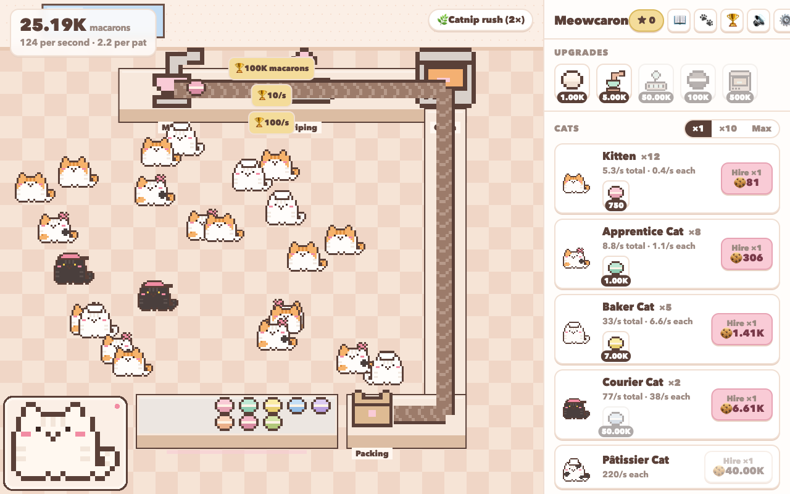

# Meowcaron 🐱🍪

A cozy pixel-art idle clicker set in a tiny macaron factory: pat the shop cat, hire cats that roam the floor, upgrade the machines, serve walk-in customers, bake billions of macarons, then open a new shop for permanent stars. Built as the first title of a reusable idle-game pipeline aimed at CrazyGames.





## What is in v0.1

- **Top-down kitchen (Overcooked-style 3/4 view)**: an L-shaped work counter with mixer → piping → oven on top and a conveyor running along it down to the packing box; macarons flow faster as production grows. Each machine has three visible upgrade tiers (steel → copper → gold → sparkling) and each station powers one system: mixer → patting, piping → all cats, oven → offline rate, packing → customer orders.
- **Cats with fur, not palette swaps**: the first seven cats are ordinary house cats (orange-and-white, calico, white, black, cow, orange tabby, grey-and-white); the last three are macaron-coloured "magic" cats. All art is generated from string templates in `src/game/sprites/pixel.ts`.
- **Roaming + petting**: hired cats wander the whole floor and stop at machines to work. Tap one and it reacts in its own happy way (hops, purring wiggles, or flopping over for belly rubs), meows, pays a few pats' worth of macarons (20 s cooldown per cat) and becomes *loved*: that cat type produces ×1.25 for 60 s, shown by a heart over its head and in its shop row.
- **Journal**: a little diary — tap any cat row (or the 📖 button) for a polaroid portrait, a persona, a short story and sticky notes with likes, favourite flavour and how it reacts to petting. Locked cats show a blank page. The shop cat's nameplate at its feet opens a rename dialog.
- **Customers**: the display counter sits at the front of the shop with the macaron stock on it; every 35–70 s a house cat walks up from the street to order. Tap it while it waits for a bonus (≈ 1 min of production, capped at 20 % of the bank).
- **Idle backbone**: offline earnings, Catnip rush (optional rewarded ad, 2× for 2 min), achievements (+1 % each), prestige stars (+5 % each) and a star shop.

## Run

Requires Node ≥ 16.13 (tooling is pinned to versions that still support Node 16: Vite 4, Playwright 1.44).

```bash
npm install
npm run dev        # http://localhost:5173
npm run build      # production build → dist/ (≈1.5 MB, Phaser is the bulk)
npm run preview    # serve dist/ on http://localhost:4173
```

Append `?platform=crazygames` to load the CrazyGames SDK adapter; by default a mock platform is used (rewarded ads show a 1.5 s placeholder).

## Verify

```bash
npm run typecheck
npm run sim                                   # headless economy bot, prints pacing milestones + PASS/FAIL checks
npm run sim -- --minutes 90 --active 10       # 10 min active play, then idle
npm run sim -- --minutes 180 --prestige       # prestige loop at 10★
npx playwright install chromium               # once
npm test                                      # 26 browser tests (desktop + Pixel 5), screenshots in test-results/
RECORD_GIF=1 npx playwright test tests/tools/gif.spec.ts --project=desktop && python3 tests/tools/make-gif.py test-results/gif-frames docs/screenshots/gameplay.gif 600
```

## Layout

```
src/core        engine, theme-agnostic: economy.ts (pure math), save.ts, controller.ts (loop/persistence), events.ts, audio.ts, platform/ (adapter + mock + crazygames)
src/content     theme: cats.ts (generators), coats.ts (fur), upgrades.ts (incl. equipment), achievements.ts, journal.ts (personas), palette.ts
src/game        Phaser: scenes/CafeScene.ts (room, belt, roaming cats, customers), sprites/pixel.ts (all art from string templates — no image assets)
src/ui          DOM shop panel, journal, modals, tooltip
sim/            headless balance simulator
tests/          Playwright specs; tests/tools/sheet.spec.ts renders a sprite sheet, tests/tools/gif.spec.ts + make-gif.py record the README GIF (RECORD_GIF=1)
docs/           screenshots, CrazyGames submission checklist, development report
```

## Design summary

| Loop | Mechanic | Target |
| --- | --- | --- |
| seconds | pat the cat (+combo particles), buy cheapest cat | first purchase < 30 s |
| minutes | 10 cat types, ×2 tier upgrades at 1/10/25/50/100 owned, click upgrades, +10% globals | first upgrade < 3 min, 100/s by 10 min |
| session | achievements (+1% each), Catnip rush (rewarded ad, 2× for 2 min) | 10+ min sessions |
| days | offline earnings (50 %, 8 h cap, optional ad to double), prestige for stars (+5 %/★), star shop | first prestige at 25–60 min, D1 return |

Economy constants live in `src/core/economy.ts` (`PRESTIGE`, `OFFLINE`) and `src/content/cats.ts`. Change them, run `npm run sim`, and read the milestone table.

## Making the next game

Keep `src/core` and `src/ui`, replace `src/content/*` (names, costs, coats, personas) and the sprite/prop templates in `src/game/sprites/pixel.ts`. The simulator and tests only depend on ids exported from `src/content`.
